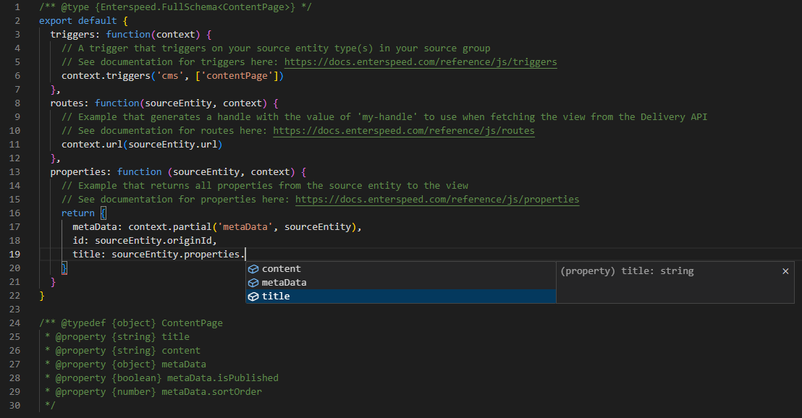

Enterspeed doesn't know the structure of the data you ingest. Describe your source entity with a [JSDoc](https://jsdoc.app/) type definition to get IntelliSense on your custom properties.

Create a `@typedef` for your source entity and pass it to the generic schema type, such as `Enterspeed.FullSchema<ContentPage>`.

<CodeGroup>
```js Content page schema icon="square-js"
/** @typedef {object} ContentPage
 * @property {string} title
 * @property {string} content
 * @property {object} metaData
 * @property {boolean} metaData.isPublished
 * @property {number} metaData.sortOrder
 */

/** @type {Enterspeed.FullSchema<ContentPage>} */
export default {
  triggers: function(context) {
    context.triggers('cms', ['contentPage']);
  },
  routes: function(sourceEntity, context) {
    context.url(sourceEntity.url);
  },
  properties: function (sourceEntity, context) {
    const p = sourceEntity.properties;
    return {
      title: p.title,
      content: p.content,
      isPublished: p.metaData.isPublished
    };
  }
}
```
</CodeGroup>

The editor now suggests your custom properties when you work with the source entity.



<Tip>
You don't have to write type definitions by hand. Paste the JSON from your source entity into a tool such as [transform.tools](https://transform.tools/json-to-jsdoc) to generate them.
</Tip>

<Card title="JSDoc" icon="book" horizontal href="/enterspeed/reference/js/jsdoc">
  More examples, including how to type the results of lookups and the parameters of custom functions.
</Card>
